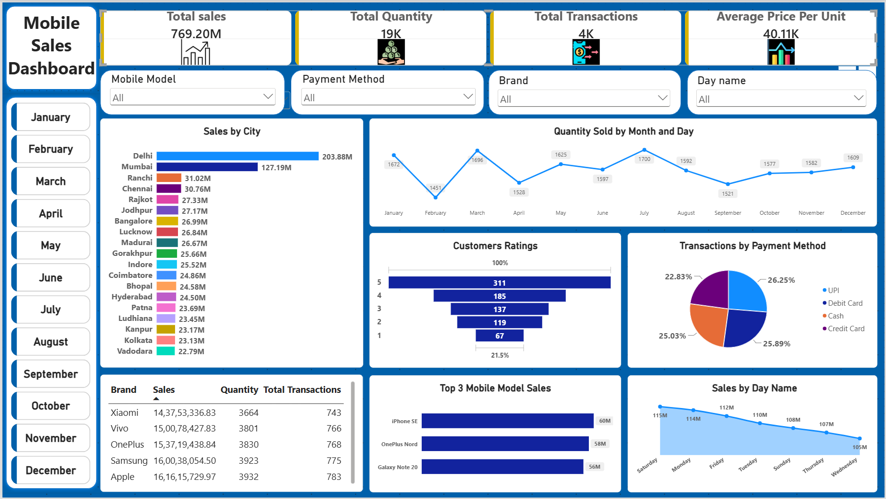

# Mobile Sales Dashboard using Power BI

## Project Overview
An interactive Power BI dashboard for analyzing mobile sales, quantities, transactions, customer ratings, and payment methods.

## Tools & Technologies
- Power BI Desktop
- Power Query
- DAX
- Microsoft Excel

## Key Features
- **Sales Overview:** Displays Total Sales, Total Quantity, Total Transactions, and Average Price per Unit.
- **City-wise Analysis:** Visualizes sales distribution across cities.
- **Monthly Analysis:** Tracks quantity sold across months.
- **Brand and Model Analysis:** Compares sales across mobile brands and models.
- **Payment Method Analysis:** Shows the distribution of transactions by payment method.
- **Customer Ratings:** Presents customer rating counts.
- **Interactive Filters:** Allows users to filter data by mobile model, payment method, brand, day name, and month.

## Data Preparation
Used Power Query to prepare the dataset, create a date column from separate date fields, and set appropriate data types.

## DAX Measures
Created four measures:
- Total Sales
- Total Quantity
- Total Transactions
- Average Price per Unit

## Dashboard Preview

## Files Included
- `Mobile_Sales_Dashboard.pbix` — Power BI dashboard file.
- `Dashboard_Screenshot.png` — Dashboard preview.
- `Mobile Sales Data.xlsx` — Source dataset used for the analysis.
- `Average Price Per Unit.jpeg` — Average price metric icon.
- `Total Quantity.jpeg` — Total quantity metric icon.
- `Total Sales.jpeg` — Total sales metric icon.
- `Total Transactions.jpeg` — Total transactions metric icon.

## Author
**Md Ziyauddin**

GitHub: [ziyauddinofficial01-dev](https://github.com/ziyauddinofficial01-dev)
